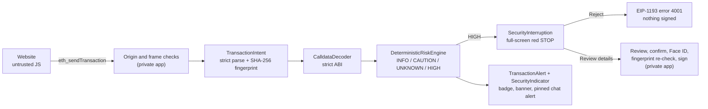

<p align="center">
  
</p>

<h1 align="center">Mona Guard</h1>

<p align="center">
  <b>The deterministic transaction firewall inside MonaSurf, a Web3 browser for Monad.</b><br>
  Public security-engine demonstration · Monad Metropolis · Trust, Identity &amp; AI Infrastructure
</p>

<p align="center">
  
  
  
  
  
</p>

---

> **The site says “Claim rewards”. The wallet request says “let 0x…dEaD spend all your WMON, forever.”**
> Mona Guard reads the request itself instead of the page, and stops the user before they sign.

## For reviewers: 3-minute evaluation

| Step | What to do | What you should see |
|---|---|---|
| 1 | `swift test` | `Executed 83 tests, with 0 failures` |
| 2 | `swift run nebuladrop-check` | The fake “Claim Rewards” request rated **High risk**, with the red **“STOP. THIS IS NOT A REWARD CLAIM.”** content, while a 5 WMON approval and a revoke are not |
| 3 | Read [`DeterministicRiskEngine.swift`](Sources/MonaGuard/Risk/DeterministicRiskEngine.swift) and [`SecurityInterruption.swift`](Sources/MonaGuard/Risk/SecurityInterruption.swift) | Plain rules on decoded calldata. No AI, no network and no page content in the verdict |
| 4 | Open the on-chain evidence below | Real transactions signed by the MonaSurf app on Monad Testnet after its review |

**On-chain evidence from the full app (Monad Testnet, chain 10143):**

| Transaction | What it shows | Explorer |
|---|---|---|
| PuddleSwap swap, 1 MON → USDT | A real third-party dApp going through the same review and signing flow | [0x613c7c92…](https://testnet.monadscan.com/tx/0x613c7c92131059307bee0bc3bc13ae0d66524d3d141831443a45e2b54b0cd26a) |
| Bounded approval, 5 WMON | A limited approval, which the engine distinguishes from an unlimited one | [0xdc2945bf…](https://testnet.monadscan.com/tx/0xdc2945bf1958f53b7aedb055f4a836c198c34632c92fe2df7a9a2d785fd8909b) |
| Unlimited approval (explicit override test) | A HIGH request can only go through after an explicit acknowledgement, confirmation and Face ID | [0x3fe74e64…](https://testnet.monadscan.com/tx/0x3fe74e647725c3be0cd7c67a664eb34a9922d2498924736a3ee56180352d15d9) |
| Native self-transfer | The basic signing path on testnet | [0x563cd829…](https://testnet.monadscan.com/tx/0x563cd829596173caa1d83f937cd1469d4cebd53b0a2154c447b839f12d54f072) |

The video in the hackathon submission shows the full app on a physical iPhone, including the NebulaDrop interruption.

## What this repository is

[MonaSurf](#about-monasurf) is a native iOS Web3 browser with a built-in wallet, running on **Monad Testnet (chain 10143)**. Every wallet request a website makes goes through **Mona Guard** before the user can sign it.

This repository contains **only that security engine**, extracted from the full app as a standalone Swift package so anyone can build it, read it and test it. The iOS app, the wallet, the signing infrastructure, the Keychain integration, the backend and the AI services stay private (see [What is not included](#what-is-not-included)).

## What it proves

| Claim | Where to check |
|---|---|
| Risk comes from **decoded calldata**, not from how the website looks or what it says | `DeterministicRiskEngine`, `CalldataDecoder` |
| An unlimited ERC-20 approval is **HIGH** from the calldata alone: no network, no AI, no delay | `SecurityInterruptionTests.testNebulaClaimProducesRedInterruptionFromDecodedCalldata` |
| The red “STOP” interruption compares what the site **promised** with what the request **actually** does, naming the exact token contract and spender | `SecurityInterruption`, `swift run nebuladrop-check` |
| Bounded approvals and revocations are told apart from unlimited ones, and get no red interruption | `testNoInterruptionForBoundedOrRevoke` |
| There is **no “safe” level**: unknown selectors, malformed ABI and missing on-chain checks fail closed to **UNKNOWN** | `RiskLevel`, `RiskEngineTests`, `CalldataDecoderTests` |
| A website cannot label itself: the “training demo” label comes only from native constants | `TrainingDemo`, `DemoOrigins`, `testTrainingDemoWarningComesFromNativeMetadataOnly` |
| Alerts only escalate. A rejected or cancelled risky request never turns green and never hides a red site warning | `TransactionAlertBook`, `SecurityIndicator`, `TransactionAlertTests` |
| Requests are frozen and fingerprinted (SHA-256), so what the user reviewed is exactly what gets signed | `TransactionIntent`, `TransactionIntentTests` |
| Revocation is the standard `approve(spender, 0)` on the same token, and the allowance read is `allowance(owner, spender)` | `AllowanceCalls`, `testRevokeCalldataTargetsSameSpenderWithZero`, `testAllowanceCalldata` |

## Quick start (about 1 minute)

Requirements: macOS 14+ with Xcode 15+ or a Swift 5.9+ toolchain. No dependencies, no network access, no keys.

```bash
git clone https://github.com/0x0bob/monasurt.git
cd monasurt
swift test                  # 83 unit tests
swift run nebuladrop-check  # replays NebulaDrop's "Claim Rewards" request through the engine
```

Expected output from `swift run nebuladrop-check` (abridged):

```text
=== NebulaDrop "Claim Rewards" (unlimited approval) ===
Risk:      High risk
Headline:  Unlimited token approval
  • [High risk] Unlimited allowance (MAX uint256): Lets 0x…dead move any amount of token contract
    0xfb8bf4c1…c541 from your wallet, now or later, until you revoke it. …

  ┌ RED INTERRUPTION: STOP. THIS IS NOT A REWARD CLAIM.
  │ This website promised you rewards, but it is asking for unlimited permission to spend your WMON tokens.
  │ PROMISED: Claim 5,000 NEB (fictional reward)
  │ ACTUAL:   Unlimited WMON approval
  │ Once approved, this permission can remain active until revoked. …
  └ Buttons: [Reject transaction]  (Review technical details)

=== Limited approval (5 WMON) ===
Risk:      Unknown / unverified
  (no red interruption: not HIGH risk)

=== Revoke (approve spender, 0) ===
Risk:      Unknown / unverified
  (no red interruption: not HIGH risk)
```

The command runs fully offline on purpose. Without on-chain context the engine reports “On-chain checks unavailable” and fails closed to **UNKNOWN** rather than guessing. In the app, the same requests are additionally checked against live Monad Testnet RPC data (contract code, token metadata, gas estimation).

## The NebulaDrop demo

[`Demo/NebulaDrop.html`](Demo/NebulaDrop.html) is a **fictional** airdrop page bundled inside MonaSurf to show a typical wallet-drainer pattern safely:

- The page advertises **“Claim 5,000 NEB”**. NEB does not exist.
- **Claim Rewards** actually sends `approve(0x…dEaD, MAX_UINT256)` on the real canonical **WMON** contract on Monad Testnet.
- The spender is the **burn address**, which nobody holds a key for, so even an accidental approval cannot be exploited.
- The page never asks for a password or recovery phrase, does not imitate any real protocol, and is **not hosted publicly**. In the app it is served from a private `shield-demo://` URL scheme that no website can claim.

The page only works inside MonaSurf, which provides the EIP-1193 wallet. Opened in a normal browser it simply reports that no wallet is available.

## How a request flows through MonaSurf



Steps marked *(private app)* are not in this repository and are shown for context only. Full details are in [docs/ARCHITECTURE.md](docs/ARCHITECTURE.md).

**AI in MonaSurf explains, it never decides.** The app's assistant (Mona) can describe a finding in plain language, but it cannot lower a risk level, approve or sign anything. The red interruption is drawn from deterministic results before any AI or network call returns.

## Repository layout

```text
Sources/MonaGuard/
  Risk/       CalldataDecoder, DeterministicRiskEngine, RiskModels, TransactionIntent, SecurityInterruption
  Monitor/    TransactionAlert (+ SecurityIndicator), SiteVerdict, URLHeuristics
  Chain/      UInt256, Address/Hex, MonadNetwork constants, KnownToken (testnet registry)
  Web3/       DemoOrigins (bundled-page origins)
  PublicAPI.swift   MonaGuardEngine.review(…): small read-only public entry point
Sources/nebuladrop-check/   command-line replay of the NebulaDrop request
Tests/MonaGuardTests/       83 XCTest cases
Demo/NebulaDrop.html        the fictional deceptive dApp
docs/ARCHITECTURE.md        design, trust boundaries, limitations
```

## Test coverage

| Suite | Tests | Covers |
|---|---:|---|
| `RiskEngineTests` | 21 | Unlimited, near-max and bounded approvals, revokes, transfers, `setApprovalForAll`, unknown selectors, simulation failures, offline fail-closed, hostile token symbols, no “safe” level |
| `CalldataDecoderTests` | 16 | Strict ABI decoding, non-canonical bools, dirty address bits, short/trailing calldata, V2 swaps and recipients, WMON wrap/unwrap |
| `TransactionIntentTests` | 12 | Strict request parsing, mainnet and wrong-account rejection, unknown fields, size limits, site gas limit ignored, fingerprint stability |
| `TransactionAlertTests` | 10 | HIGH overrides a green site status, de-duplication, escalate-only levels, rejection history, tab/origin isolation, alerts cannot sign |
| `MonitorTests` | 9 | URL phishing patterns and brand look-alikes, “no known threats” is not “safe”, reputation failures never green, alert de-duplication |
| `SecurityInterruptionTests` | 8 | Red interruption content, no invented promises, training-demo trust, revoke/allowance calldata |
| `UInt256Tests` | 7 | 256-bit parsing, overflow rejection, hex quantities, lossless decimal formatting |

## What is not included

Kept private, and **not needed** to verify the engine:

- The complete iOS application (SwiftUI browser, WKWebView EIP-1193 bridge, UI)
- Wallet implementation, key generation and the signing pipeline
- Keychain and Face ID integration
- The backend service, AI prompts and third-party AI/intelligence integrations
- Deployment configuration, credentials and signing identities

This package contains **no private keys, API keys, private endpoints or credentials**, and no code that signs or broadcasts transactions.

## Limitations

Read this before drawing conclusions:

- **Testnet only.** The engine knows Monad Testnet (10143). Mainnet is deliberately not supported.
- **Selector coverage is finite.** It decodes ERC-20 `approve` / `transfer` / `transferFrom`, ERC-721/1155 `setApprovalForAll`, Uniswap-V2-style swaps and WMON `deposit` / `withdraw`. Anything else is reported as **UNKNOWN**, never as safe.
- **Not a malware oracle.** HIGH means “this request grants dangerous power”, not “this spender is proven malicious”. NebulaDrop's spender is the inert burn address.
- **Message signing is out of scope** (`personal_sign`, `eth_signTypedData`, Permit/Permit2) for this extract.
- **No Public Suffix List and no keccak** in this package, so URL heuristics approximate registrable domains and addresses are shown in full lowercase instead of EIP-55 checksum form.
- **Offline replay.** `nebuladrop-check` uses no RPC, so on-chain checks are reported as unavailable. Live RPC enrichment exists only in the private app.
- **Extracted code.** These files are copied from the app with network calls and app-only glue removed. Comments may refer to app screens that are not part of this repository.

## About MonaSurf

MonaSurf is an iOS Web3 browser for Monad, built for the **Monad Metropolis** hackathon (Trust, Identity & AI Infrastructure track):

- **Mona Guard** is the deterministic firewall in this repository.
- **Mona** is the in-app assistant, which explains findings in plain language.
- The app's wallet is real and runs on Monad Testnet. Every signature needs explicit in-app confirmation and Face ID.

*Policy decides. AI explains. You control the signature.*
